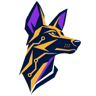

<p align="center"></p>

<h1 align="center">Witch Dog</h1>

<p align="center"><strong>Agentic Security. Continuous Vigilance.</strong></p>


[](#where-it-runs)
[](LICENSE)
[](#requirements)
[](#where-it-runs)
[](.github/workflows/intelligence.yml)

*One checklist. One prompt. Your environment.*

Witch Dog is an **open-source, model-agnostic security investigation kit** combining deterministic host/repository inspection, continuously refreshed public threat intelligence, and human-supervised AI-assisted security fixes. Works with OpenCode and any provider/model supported by your OpenCode installation.

> **Project status:** experimental v0.1 bootstrap. The inspector is a conservative source/host **discovery tool**, not an EDR, penetration test, exhaustive malware scanner, or proof that production is safe. Never give an AI agent root, production secrets, or unattended production-change authority.

## Quick start

Clone Witch Dog alongside the projects you want to inspect:

```text
workspace/
├── 1bis-witchdog/       ← clone here
├── project-a/
├── project-b/
├── project-c/
└── project-d/
```

```bash
git clone https://github.com/gabalmighty/1bis-witchdog.git
cd 1bis-witchdog
```

**One prompt for OpenCode** (run inside the Witch Dog directory; replace the model with an available one):

```bash
opencode run --agent witchdog --model opencode-go/hy4-flash-free "Follow PROMPT.md. Inspect this local host and Git repositories under .. using the maintained checklist. Begin read-only; report evidence and unknowns. Propose code fixes and PRs, but request explicit approval before any write, push, or remediation."
```

For a **deterministic scan without AI**, run this first (recommended for scheduled jobs):

| Linux / macOS | Windows PowerShell |
| --- | --- |
| `python3 tools/witchdog.py scan --root .. --output .witchdog/runs` | `py -3 tools/witchdog.py scan --root .. --output .witchdog/runs` |

The output stays local in `.witchdog/runs/` (gitignored). Open `report.md` and `scan.json` there. **Do not upload customer evidence or private scan results to this public repository.**

## Scan a website or web application (WEB-01)

**New:** a separate URL-based security workflow informed by OWASP WSTG v4.2, ASVS 5.0.0, OWASP Top 10:2025 and OWASP API Security Top 10:2023.

Run the same OpenCode agent with the **website prompt**:

```bash
opencode run --agent witchdog --model opencode-go/hy4-flash-free "Follow web_prompt.md. Target: https://YOUR-STAGING-APP.example. I own or have explicit authorization to test this exact origin. Run BASELINE only. Assess against checklists/webapp-vapt-v1.md; report observed risks and untested controls as UNKNOWN. No crawling, active attacks or unapproved changes."
```

Or run a deterministic HTTPS baseline without an AI model:

```bash
python3 tools/web_baseline.py --target https://YOUR-STAGING-APP.example --authorized --output .witchdog/web-runs
```

Windows PowerShell: replace `python3` with `py -3`. `--authorized` affirms permission to inspect that **exact** origin. The baseline makes **one** GET request to `/`, verifies TLS, observes selected headers and cookie flags, and does not follow redirects, crawl, authenticate, fuzz or exploit. Most VAPT controls remain `UNKNOWN` until separately authorized UAT/manual work. Reports remain private in `.witchdog/web-runs/`; `manifest.json` contains SHA-256 evidence identifiers (not signatures). Run `python3 tools/validate_web_report.py --report .witchdog/web-runs/report.json` to enforce the baseline report contract. See [website testing guidance](docs/webapp-testing.md).

### Interpreting your first website report

Witch Dog's fast root-only baseline is intentionally a low-impact **configuration observation**, not penetration testing. Its report identifies high-impact authentication, authorization, API and data controls as **UNKNOWN**, and labels overall assurance `NOT_A_VAPT`. Header-value checks are conservative: a policy that exists but is weak may still be a WARN. Historical Critical findings from prior audits must be retested separately, not silently closed by a baseline.

See [pilot interpretation and verification lessons](docs/web-baseline-pilot-lessons.md) for quality gates and future test priorities.

## How it works

```text
        TRUSTED PUBLIC ADVISORIES           LOCAL AUTHORIZED ASSETS
       Zero Wire / CISA KEV / vendors       Windows / Linux / VM / repos
                   │                                  │
             scheduled parser                  deterministic discovery
                   │                                  │
           reviewed intel PR                         │
                   └─────────────────┬────────────────┘
                            Witch Dog analyst
                 evidence + uncertainty + relevance
                                     │
                         proposed fix + tests
                                     │
                          human-reviewed PR
                                     │
                       deployed runtime verification
```

**Trust boundaries:** Public internet content is untrusted DATA, not executable instructions. Local secret values are never deliberately collected by the baseline inspector. The AI prompt does not grant extra operating-system privileges; OpenCode permissions are not a security sandbox.

## Where it runs

| Environment | Available today | Not inferred |
| --- | --- | --- |
| Developer laptop (Windows/Linux/macOS) | OS family, tool availability, local Git workspaces and source checks | Other machines' live configurations |
| Linux/Windows application VM | Same local checks, relevant platform hints | Root/administrator state, live ports, deployed patch status unless separately verified |
| Folder containing several Git repositories | Recursively discovers bounded Git roots and audits each separately | Undiscovered repos / inaccessible submodules |
| Hyper-V/KVM host | Capability preflight, source/host discovery | Guest visibility without explicitly authorized access |
| Isolated disposable VM | Architecture and preflight documented | **Provisioning is not implemented in v0.1** |
| GitHub Actions | Twice-daily deterministic threat-feed refresh and PR proposal | Private client scanning; auto-patches |

The scanner intentionally distinguishes `SOURCE_DECLARED`, `REMOTE_OBSERVED` and `LIVE_VERIFIED`. A fixed Dockerfile is **not** proof that a running pod uses that image.

## Modes

- **Audit (default):** bounded read-only evidence collection and explicit `PASS / FAIL / WARN / UNKNOWN / N/A`.
- **Scan & Fix (supervised):** an agent can investigate and propose fixes on a target repository's feature branch, run authorized tests and open a review PR. No automatic merge/deploy; source changes require explicit approval.
- **Disposable (planned):** preflight virtualization, disk, credentials, network scope and cleanup; eventual isolated execution. [Specification](docs/disposable-execution.md).

## Requirements

Python 3.11+, Git, and (optional) OpenCode v2 with your chosen authenticated model. Deterministic scans and public intelligence ingestion use the Python standard library. No commercial security agent is required for basic discovery.

OpenCode must run with suitable restricted permissions. `opencode.jsonc` is an **approval policy**, not a sandbox. For unattended use, run the deterministic Python tooling inside a restricted OS identity; perform AI analysis only on approved/sanitized evidence.

## Intelligence automation

[Scheduled workflow](.github/workflows/intelligence.yml) runs at **00:23 and 12:23 UTC** (08:23 and 20:23 PHT) on the default branch. It fetches allowlisted Cloudflare Zero Wire RSS and CISA KEV JSON, normalizes them to [data/intel/latest.json](data/intel/latest.json), and **opens or updates a PR** if content changes. It never auto-merges. Model-generated research/edits are a future gated phase; a free model does not justify giving untrusted content privileged CI access.

GitHub-hosted Actions are normally free on public repositories but still have policy and service limits; scheduled runs can be delayed and can be disabled after prolonged inactivity. [Operations](docs/operations.md).

## Security checklist and guidance

- [Universal one-prompt contract](PROMPT.md)
- [Platform-agnostic checklist](checklists/security-v1.md)
- [URL website testing prompt](web_prompt.md) and [webapp VAPT checklist](checklists/webapp-vapt-v1.md)
- [Website testing guidance](docs/webapp-testing.md) and [pilot design learnings](docs/agentic-pilot-learnings.md)
- [Architecture and trust boundaries](docs/architecture.md)
- [Scheduled jobs and contribution workflow](docs/operations.md)
- [Disposable VM acceptance gates](docs/disposable-execution.md)
- [Reporting vulnerabilities responsibly](SECURITY.md)
- [How to contribute](CONTRIBUTING.md)

## GitHub repository topics (maintainer setup)

`agentic-security` · `devsecops` · `vulnerability-management` · `security-automation` · `sbom` · `threat-intelligence` · `opencode` · `windows` · `linux` · `self-hosted`

## License and brand

Code and included logo asset are released under [MIT](LICENSE). The Witch Dog name and identity may have separate trademark considerations; the MIT license does not grant trademark endorsement. Public contributions must not include client details, secrets, scan outputs or internal infrastructure identifiers.

Built by the Witch Dog community. Contributions and reproducible issue reports welcome.
